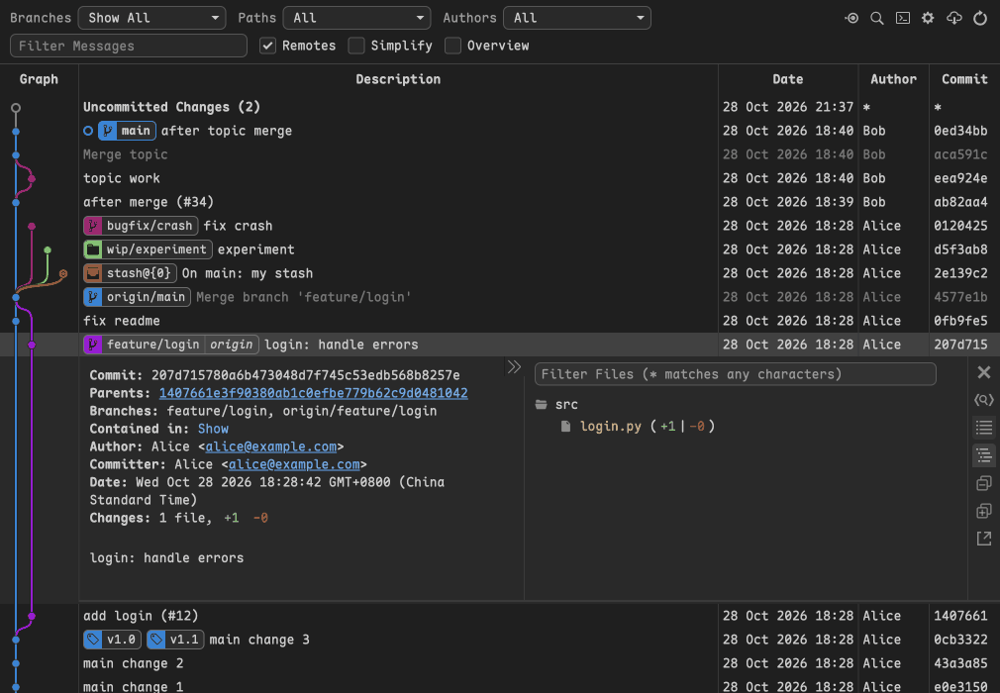

# Easy Graph

[English](../README.md) · **简体中文**

> 扩展详情页与市场页只显示英文版 README。命令标题、设置说明和扩展消息会随 VS Code 显示语言切换为中文，图形界面保持英文。

在 VS Code 里用一张提交图查看仓库的全部分支，并直接在图上 rebase、merge、cherry-pick 或 reset。

Easy Graph 适合习惯在提交图上、而不是在终端里做 Git 操作的开发者。Git Graph 自 2021 年 4 月的 1.30.0 之后没有再发布，Easy Graph 在 Git Graph 2 的 1.31.8 版基础上继续开发。和 VS Code 内置的源代码管理图不同，它在一张表里显示全部分支、标签、stash 和未提交的改动，并从它们的右键菜单执行 Git 操作。它不上报任何使用事件，可以与 Git Graph、Git Graph 2 同时安装。

[](https://marketplace.visualstudio.com/items?itemName=heavensky.easy-graph)
[](https://marketplace.visualstudio.com/items?itemName=heavensky.easy-graph)



## 快速开始

1. 从 [VS Code 扩展市场](https://marketplace.visualstudio.com/items?itemName=heavensky.easy-graph)安装 Easy Graph。
2. 单击源代码管理视图里的 **View Easy Graph** 按钮，或在命令面板（`Ctrl+Shift+P`，macOS 上是 `Cmd+Shift+P`）执行 `Easy Graph: 查看 Easy Graph（git log）`（英文界面下是 `Easy Graph: View Easy Graph (git log)`）。
3. 单击提交查看它改动的文件，在提交、分支或标签上右键执行 Git 操作。

设置使用 `easy-graph.` 前缀，Git Graph 的设置不会沿用过来。想保留它们，在 `settings.json` 里复制一份，把副本的前缀 `git-graph.` 改为 `easy-graph.`。签名、fetch 清理、快进等 Git 相关行为跟随仓库的 Git 配置（`git config`）；只想对 Easy Graph 生效时，在 `easy-graph.builtin` 中用 Git 原名设置该项，例如 `{ "commit.gpgSign": true }`。

## 不开终端也能处理中断的 rebase

rebase、merge、cherry-pick 或 revert 中途停下时，提交图上方会出现横幅，提供 **Continue**、**Skip Commit** 和 **Abort**。**Rebase...** > **Interactive Rebase (Todo Editor)** 里拖动提交即可调整顺序，并为每个提交选择 pick、reword、edit、squash、fixup 或 drop。详见[完成 rebase 和 merge](CHANGELOG.md#完成-rebase-和-merge)。

## 一步改写多个提交

用 Ctrl/Cmd+单击或 Shift+单击选中多个提交，**Squash**、**Drop**、**Cherry Pick** 和 **Revert** 就会作用于所有选中的提交。**Create Fixup Commit** 把已暂存的改动提交为 `fixup!` 提交，Rebase 对话框里勾选 **Autosquash** 后会把它并入目标提交。详见[一次操作多个提交](CHANGELOG.md#一次操作多个提交)。

## 只看需要的提交

**Filter Messages** 在全部历史中搜索提交信息，而不只是已加载的提交。**Authors** 和 **Paths** 下拉框可以进一步缩小范围；在资源管理器里右键文件或文件夹，选择 **在 Easy Graph 中按此路径筛选**，提交图只显示改动过这个路径的提交。`easy-graph.excludeBranchGlobPatterns` 可以隐藏 `gh-pages`、`wip/*` 这类分支。详见[筛选与查找提交](CHANGELOG.md#筛选与查找提交)。

## 把提交图放在代码旁边

**Easy Graph: 在面板中查看 Easy Graph** 在面板中打开提交图，编辑代码时也一直看得到。把 `easy-graph.viewLocation` 设为 `panel`，以后每次都在面板中打开。详见[调整视图](CHANGELOG.md#调整视图)。

## 不适用的场景

想用原维护者发布的版本，请用 [Git Graph 2](https://marketplace.visualstudio.com/items?itemName=hansu.git-graph-2)。只需要浏览历史的话，VS Code 内置的源代码管理图不用装扩展。Easy Graph 需要 VS Code 1.101 或更新版本。

## 延伸阅读

- [更新日志](CHANGELOG.md)列出每个版本的变化，其中 0.0.1 一节列出与 Git Graph 1.30.0 相比的全部差异，包括修复的问题。
- 在扩展视图中打开本扩展的详情页，**Feature Contributions** 标签页列出全部命令和设置。

想试用尚未发布的改动，在 `packages/easy-graph` 下构建安装包，再在扩展视图的 **...** 菜单里选择 **Install from VSIX...** 安装 `artifacts/easy-graph-0.0.1.vsix`：

```sh
npm ci && npm run package
```

## 许可证

[MIT](../LICENSE.txt)
