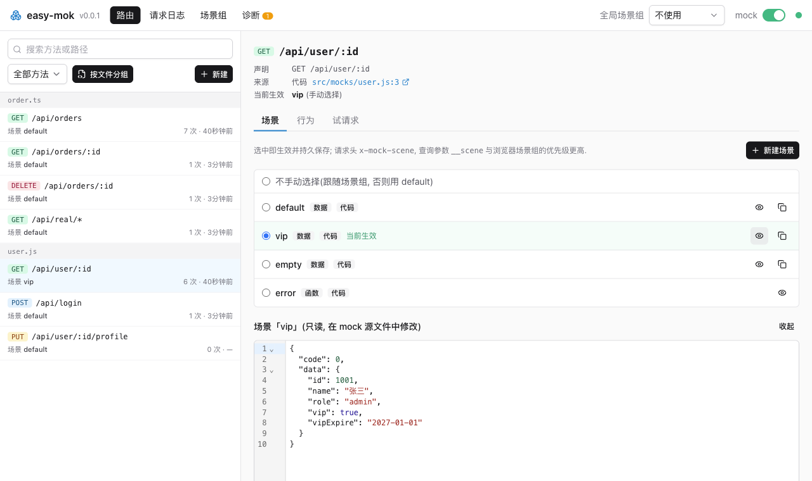
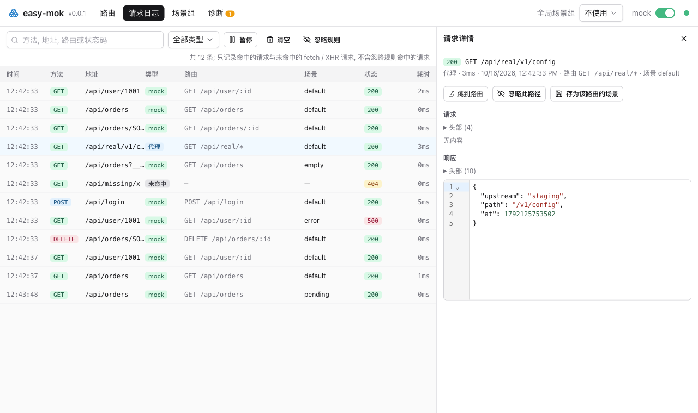
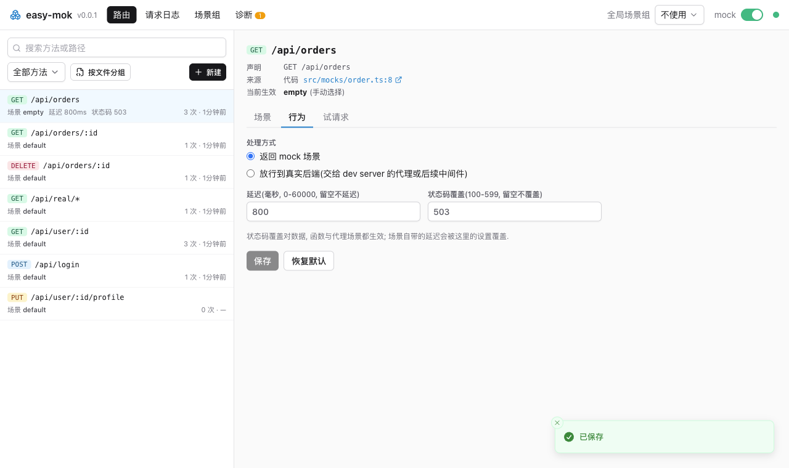
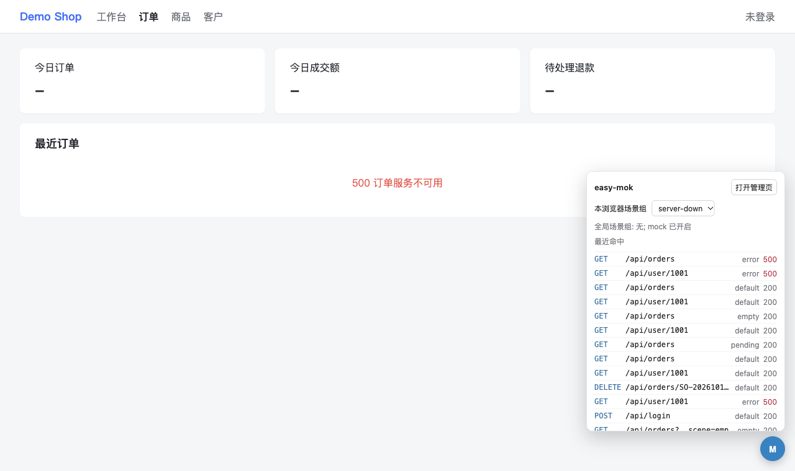

# easy-mok

**English** · [简体中文](./zh/README.md)

Write each API mock once, then switch scenes, delays, and status codes in your browser and save real responses as mocks, with no code edits or dev server restarts.

[](https://www.npmjs.com/package/easy-mok)
[](https://www.npmjs.com/package/easy-mok)
[](LICENSE)

easy-mok is for frontend developers who build against APIs that are unfinished, unstable, or hard to put into a specific state. Your mocks live in plain JS, TS, or JSON files, and one set of files works with Vite, webpack-dev-server, Express, Fastify, Connect, `node:http`, or a standalone `npx easy-mok` server. Hand-written mocks need a code change for every "empty list" or "server error" you want to see; with easy-mok you **switch them at runtime from the admin page at `/__mock/` or from a floating bar inside your own page**.



The admin page and the floating bar display Chinese text; the guide gives the English meaning of each label.

## Get your first mock running

You need Node.js 18 or later.

1. Install easy-mok in your project:

   ```bash
   npm i -D easy-mok
   ```

2. Create `src/mocks/user.js`; easy-mok picks up changes as soon as you save:

   ```js
   const { scenes } = require("easy-mok");

   module.exports = {
   	"GET /api/user/:id": scenes({
   		default: { id: 1, name: "Alice" },
   		empty: null,
   		error: (req, res) => res.status(500).json({ message: "Internal error" }),
   	}),
   };
   ```

3. Start the mock server, then open `http://127.0.0.1:4100/__mock/` to switch scenes:

   ```bash
   npx easy-mok
   ```

`curl http://127.0.0.1:4100/api/user/1` now returns `{"id":1,"name":"Alice"}`. To serve the same mocks from your existing Vite dev server instead, add the plugin:

```js
// vite.config.js
import { mockVitePlugin } from "easy-mok";

export default { plugins: [mockVitePlugin()] };
```

For webpack-dev-server, Express, Fastify, and other hosts, see [Add easy-mok to your dev server](docs/connect.md).

## Change responses without touching code

- **See the empty, error, and slow states on demand.** Declare scenes with `scenes()` or create them on the admin page, then bundle several routes into a scene group such as "logged out" or "VIP user" and switch them all at once. Enable a group for your browser only, so teammates on the same dev server are not affected, or pick a scene per request with the `x-mock-scene` header in E2E tests.
- **Know which requests hit a mock and which reached the backend.** The request log records mocked, passed-through, and unmatched fetch/XHR requests with full request and response details. Any real response becomes a scene with one click and is saved under `__scenes__/`, so you can commit it.



- **Tune delay and status code, or send one route to the real backend.** Delay (0-60000 ms) and status code overrides apply to data, function, and proxy scenes alike, and passthrough hands a single route to your dev server's proxy while the rest stay mocked.



- **Keep working while you edit mocks.** Mock files and the files they import reload on save. If an edit breaks a file, its last working routes keep serving and the admin page shows a diagnostic, so requests never silently fall through to the real server.
- **Switch scenes from inside your app.** The floating bar lets you change the scene group, see the latest mocked requests, and open the admin page without leaving the page you are testing; the Vite plugin injects it for you.



## Compare easy-mok with similar tools

easy-mok is the one in this table that switches scenes at runtime without code changes; it does not generate data or run inside unit tests.

| | easy-mok | Mock.js | vite-plugin-mock | MSW | json-server |
|---|---|---|---|---|---|
| Where it runs | Dev server middleware or standalone server | Intercepts XHR in the browser | Vite dev server | Service Worker / Node | Standalone server |
| Switch scenes without code changes | Admin page, floating bar, request header | No | No | No; override handlers in code with `.use()` | No |
| Graphical admin page | Yes | No | No | No | — |
| Request log and save as mock | Yes | No | No | No | No |
| Pass one route through to the real backend | One click on the admin page | — | — | Return `passthrough()` from the handler in code | — |
| Random data generation | No; import Mock.js or similar in a mock file | Yes | Via Mock.js | No | No |
| REST CRUD generated from a data file | No | No | No | No | Yes |
| Intercept requests directly in unit tests | No; needs a running server | — | No | Yes | No |

A dash means the row does not apply to that tool.

## When to use something else

easy-mok is a server, so it cannot intercept requests inside unit tests; use [MSW](https://mswjs.io/) there. If you only need random fake data, [Mock.js](https://github.com/nuysoft/Mock) is enough, and if you want a REST CRUD API generated from a JSON file, use [json-server](https://github.com/typicode/json-server). easy-mok is built for development only; do not mount it on a production server.

## Read more

- [Guide](docs/README.md): connect a dev server, run standalone, write mocks, switch scenes, and every option.
- [Changelog](CHANGELOG.md)

## License

[MIT](LICENSE)
