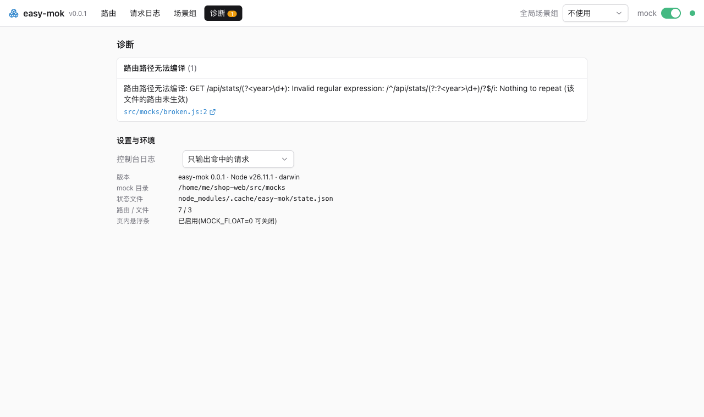

# Write mock files

**English** · [简体中文](../zh/docs/writing-mocks.md)

By the end of this page, you can declare routes, scenes, handler functions, and proxies in mock files, and know how easy-mok loads and matches them. Mock files go in the mock folder, `src/mocks` by default; to connect a host first, see [Add easy-mok to your dev server](connect.md).

## Declare routes and scenes

A mock file exports an object that maps routes to responses.

```js
// src/mocks/user.js
const { scenes } = require("easy-mok");

module.exports = {
	"GET /api/user/:id": scenes({
		default: { id: 1, name: "Alice" },             // objects, arrays, and strings are returned as is
		empty: null,
		error: (req, res) => res.status(500).json({}), // function with parameters: handle the request yourself, or call next() to hand it to the host; write the parameters out
		byId: req => ({ id: req.params.id }),          // if it neither responds nor calls next(), its return value is the response body
		now: () => ({ time: Date.now() }),              // function without parameters: called per request, return value is the response body
		real: () => ({ target: "http://test.example.com", changeOrigin: true }), // returns an object with target / router: proxy config
	}),
	"GET|POST:1 /api/list": [],                         // several methods; :1 is the weight, higher wins
	"ALL /api/legacy/*": () => ({ target: "http://old.example.com" }),
	MOCK: true,                                         // false turns mocking off for everything
};
```

Each key is `METHOD[|METHOD][:weight] path`, and each value is either a single response or a set of scenes. You only need `scenes()` when you declare several scenes in code; a plain value is the `default` scene, and you can create or record more scenes on the admin page later:

```js
module.exports = { "GET|POST /api/list": [] };
```

A route whose value is `null` responds with a JSON `null` body. A route whose value is `undefined` is skipped, so `"GET /api/beta": process.env.BETA && handler` turns a route on only when `BETA` is set.

## Use JS, TS, ESM, or JSON

Mock files can be `.js`, `.cjs`, `.mjs`, `.ts`, `.cts`, `.mts`, or `.json`, and `.d.ts` files are skipped. They load through [jiti](https://github.com/unjs/jiti), so CommonJS and ESM (`export default {...}`, `import { scenes } from "easy-mok"`) both work, and TS features such as `enum` need no extra config. Default imports of CommonJS modules work too.

An entry must export the route object with `module.exports = {...}` or `export default {...}`. Named-only exports, an exported Promise, and top-level await are not supported; a top-level await error comes with a hint.

## Share helpers and data between mocks

These files are never loaded as entries: `package.json`, `tsconfig*.json` and `jsconfig*.json`, anything in `node_modules`, and any file whose path has a segment starting with `.` or `_` (for example `_lib/util.ts`, `_data/list.json`, `_draft.js`). Put shared helpers and data in a `_`-prefixed folder; when an entry imports them, editing them still triggers a reload. The admin page's `__gui__.json` is the exception and loads as an entry, while easy-mok reads `__scenes__/` separately.

## Reload on save and read diagnostics

Mock files reload automatically when they or anything they import by relative path change, including JSON, files outside the mock folder, and modules the host already loaded. Modules imported by package name or path alias do not trigger a reload.

**When an edit breaks a file, the whole file keeps serving the routes from its last successful load**, so requests do not fall through to the real server. Breaking edits include failed imports, keys that cannot be parsed, and paths that cannot be compiled. A corrupted scene file under `__scenes__/` likewise keeps its last parseable content.



Load failures, duplicate declarations, unparseable keys, and uncompilable paths are listed on the admin page's diagnostics and printed to the terminal. Each problem prints once, prints again when it changes, and clears once fixed.

## Choose between data, handlers, and proxies

easy-mok decides what a value is from the function's `length` only and never parses its source:

- Not a function: data, returned as is.
- `length > 0`: a handler that responds itself. If it neither responds nor calls `next()`, its return value becomes the response body.
- `length === 0`: a function without parameters. If it returns an object with `target` or `router`, that object is a proxy config; otherwise the return value is the response body. The request body is not parsed.

Return values may be Promises. The admin page labels scene types the same way: a function without parameters shows as **function without parameters** (`无参函数`) until its first request, then as **function** (`函数`) or **proxy** (`代理`) depending on what it returned.

**Do not define route functions with rest parameters like `(...args) =>`, and do not give the first parameter a default value.** Their `length` is 0, so easy-mok treats them as functions without parameters: the return value becomes a proxy config or response body, and the request body is not parsed. When you handle the request yourself, write the parameters out as `(req, res, next) =>`. Functions with all parameters bound behave the same way.

## Proxy to a real backend

A scene can forward the request to a real server instead of answering it.

```js
"ALL /api/legacy/*": () => ({ target: "http://old.example.com", changeOrigin: true }),
```

A function without parameters that returns an object with `target` is a proxy scene. Proxy configs use http-proxy-middleware 3 options, and the older `onProxyReq`, `onProxyRes`, and `onError` style options still work.

Set `ws: true` to forward WebSocket connections as well. easy-mok attaches a single upgrade listener per server and routes each upgrade by the current route table, the global switch, passthrough mode, and scene. Upgrades that match no route, such as your dev server's hot-reload connection, are left alone. After a reload the old proxies are shut down, and `close()` destroys them all.

## Write route paths

Route syntax and matching follow express 4: the compiler is inlined from path-to-regexp@0.1.13, the version express 4.22 uses. It supports `:id`, `:id?`, `:id+`, `:id*`, `:id(\\d+)`, `*`, inline regular expressions, and several parameters in one segment such as `/:from-:to`. Matching is case-insensitive and the trailing slash is optional.

Parameters decode by express 4 rules, and a parameter that fails to decode returns 400. Paths that 0.1.13 cannot compile, such as named groups `(?<n>...)`, show up in diagnostics as "route path cannot be compiled" (`路由路径无法编译`). Write paths this way in express 5 projects too, because mock routes are not registered on the host's router.

Mocks match the `req.url` the middleware receives after mounting: with `app.use("/api", mock)`, `"GET /user"` matches `/api/user`.

## Know which route wins

The higher weight wins. With equal weights, the route declared first for the same path wins, and a specific method beats `ALL`. As in express, `HEAD` falls back to the `GET` route when no `HEAD` route is declared.

Preflight requests match by `access-control-request-method` and get a 204 directly; a path that declares `OPTIONS` explicitly handles them with that route.

## Read the request in a handler

Handlers can use `req.params`, `req.query`, `req.body`, `req.files`, and `req.cookies`. If the body fails to parse, for example invalid JSON, the response is 400; if it exceeds a limit, the response is 413; in both cases the handler does not run.

Limits: 5 MB for JSON, form, and text bodies; 20 MB per uploaded file; at most 10 files; 50 MB for the whole request (by `content-length`).
