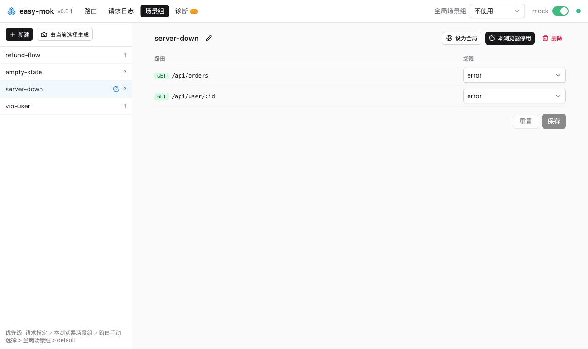

# 切换场景与响应方式

[English](../../docs/scenes.md) · **简体中文**

读完本页，你能决定每个请求拿到哪个场景，作用范围可以是自己、整个团队或单个测试请求，还能在运行时调整延迟、状态码和放行。场景来自 mock 文件里的 `scenes()` 或管理页，见[编写 mock 文件](writing-mocks.md)。

## 弄清请求拿到哪个场景

easy-mok 按以下顺序取第一个指定了场景的来源：

1. 请求头 `x-mock-scene: <场景名>` 或查询参数 `__scene=<场景名>`，用于 E2E 与多标签并行测试
2. Cookie `__mock_group=<组名>` 指向的场景组，由管理页或悬浮条上的「仅本浏览器启用」写入
3. 管理页中为该路由手动选择的场景
4. 全局场景组
5. `default`

指定的场景不存在时降到下一级，请求日志中标记为已降级。

## 在测试中按请求指定场景

```bash
curl -H "x-mock-scene: empty" http://127.0.0.1:4100/api/user/1
curl "http://127.0.0.1:4100/api/user/1?__scene=error"
```

请求头和查询参数只对这一次请求生效，不改共享状态，并行的 E2E 测试互不干扰。

## 用场景组一次切换多个接口



场景组为每个路由各选一个场景，打包在一起，例如「未登录」或「VIP 用户」。「设为全局」对所有使用这个 dev server 的人生效；「仅本浏览器启用」改为写 `__mock_group` cookie，共用 dev server 的同事保留各自的场景。

## 在管理页用脚本写场景

固定的 JSON 响应体不够用时，在场景编辑器里选「JS 脚本」，写一个处理函数，写法和 mock 文件里的一样：

```js
// 最后一条语句必须是函数；前面可以写辅助声明和注释
const user = require("./_data/user.json"); // 相对 mock 目录
(req, res, next) => ({ ...user, id: req.params.id, page: req.query.page })
```

函数拿到的 `req.params`、`req.query` 和 `req.body` 都已解析好。返回值就是响应体；也可以自己用 `res` 响应，或调用 `next()` 把请求交给 dev server。编辑器里的状态码和响应头是默认值，脚本可以覆盖。脚本 require 的本地文件保存后自动重新加载，和 mock 文件引用的文件一样。脚本保存在该路由 `__scenes__/` 下的场景文件里；无法编译的脚本在保存时就会被拒绝，手改后无法编译的会出现在诊断页。

脚本在 mock 服务进程里运行，权限和 mock 文件相同，所以即使开启了 `lan`，easy-mok 也只接受本机管理页保存的脚本场景。

## 设置延迟、状态码或放行


路由详情的「行为」标签页可以在运行时设置三件事：

- 延迟 0-60000 ms，留空不延迟。它会覆盖场景自带的延迟。
- 状态码覆盖 100-599，留空则沿用场景的状态码。对数据、函数和代理场景都生效。
- 「放行到真实后端」：该路由不再走 mock，交给 dev server 的代理或后续中间件，其余路由继续 mock。

## 关闭全部 mock

管理页顶部的开关能关闭所有路由的 mock，请求全部放行给宿主。在 mock 文件里写 `MOCK: false` 则从代码层面关闭。
